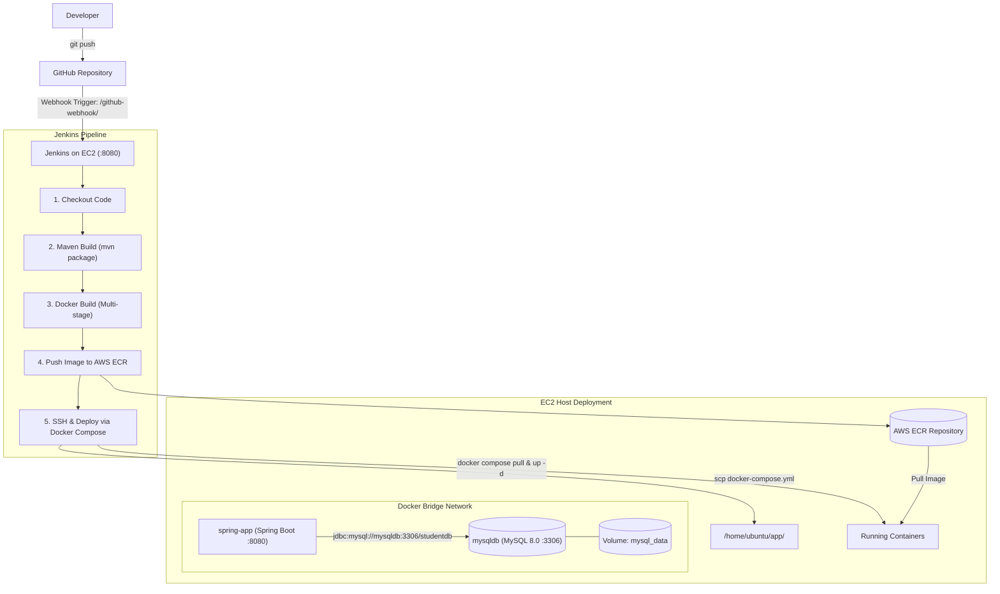

# Complete DevOps Guide: Spring Boot CI/CD with Docker, MySQL & AWS (Part 2 - #36)

This guide walks you through setting up and running the complete automated CI/CD pipeline for the Spring Boot + MySQL application using Jenkins, AWS ECR, and Docker Compose on EC2.

---

## 1. Architecture Overview



---

## 2. Step-by-Step Setup Instructions

### Step 1: AWS ECR Repository Setup
1. Log in to the **AWS Management Console**.
2. Navigate to **Amazon ECR** (Elastic Container Registry).
3. Click **Create repository**:
   - Visibility: **Private**
   - Repository name: `spring-boot-app`
4. Copy your repository URI (it will look like: `123456789012.dkr.ecr.us-east-1.amazonaws.com/spring-boot-app`).
5. Ensure you have an IAM User with the policy **`AmazonEC2ContainerRegistryPowerUser`** or Administrator access. Keep the `AWS_ACCESS_KEY_ID` and `AWS_SECRET_ACCESS_KEY`.

---

### Step 2: EC2 Instance Provisioning
1. Launch an **Ubuntu 24.04 / 22.04 LTS** EC2 instance (`t3.medium` recommended for Jenkins + Docker).
2. Configure **Security Group** inbound rules:
   | Type | Port | Source | Description |
   | :--- | :--- | :--- | :--- |
   | **SSH** | 22 | My IP (or 0.0.0.0/0) | Remote access |
   | **Custom TCP** | 8080 | 0.0.0.0/0 | Jenkins Dashboard & App port |
   | **Custom TCP** | 3306 | Optional / Private | MySQL direct access (optional) |
3. Save your `.pem` key pair (e.g., `ec2-key.pem`).

---

### Step 3: Configure EC2 with Docker & Jenkins

SSH into your EC2 instance:
```bash
ssh -i ec2-key.pem ubuntu@<EC2_PUBLIC_IP>
```

#### 1. Install Docker & Docker Compose:
```bash
sudo apt update -y
sudo apt install -y docker.io docker-compose-v2 awscli
sudo usermod -aG docker ubuntu
sudo usermod -aG docker jenkins 2>/dev/null || true
newgrp docker
```

#### 2. Run Jenkins in Docker (with Docker socket mounted):
Run this command to start Jenkins with direct access to Docker:
```bash
sudo docker run -d \
  --name jenkins \
  --restart=always \
  -p 8080:8080 -p 50000:50000 \
  -v /var/run/docker.sock:/var/run/docker.sock \
  -v $(which docker):/usr/bin/docker \
  -v jenkins_home:/var/jenkins_home \
  -u root \
  jenkins/jenkins:lts
```

Get your initial Jenkins administrator password:
```bash
sudo docker exec jenkins cat /var/jenkins_home/secrets/initialAdminPassword
```

---

### Step 4: Configure Jenkins Dashboard

1. Open your browser: `http://<EC2_PUBLIC_IP>:8080`.
2. Enter the password retrieved above and select **Install suggested plugins**.
3. Install the required Jenkins plugins under **Manage Jenkins** $\rightarrow$ **Plugins** $\rightarrow$ **Available Plugins**:
   - **Docker Pipeline**
   - **CloudBees AWS Credentials**
   - **SSH Agent Plugin**
   - **Pipeline**
4. Add Credentials under **Manage Jenkins** $\rightarrow$ **Credentials** $\rightarrow$ **System** $\rightarrow$ **Global credentials**:
   * **Credential 1: AWS Credentials**
     - Kind: **AWS Credentials**
     - ID: `aws-credentials`
     - Access Key ID: `<YOUR_AWS_ACCESS_KEY_ID>`
     - Secret Access Key: `<YOUR_AWS_SECRET_ACCESS_KEY>`
   * **Credential 2: EC2 SSH Key**
     - Kind: **SSH Username with private key**
     - ID: `ec2-ssh-key`
     - Username: `ubuntu`
     - Private Key: Paste the full text of your `ec2-key.pem` file.

---

### Step 5: Configure GitHub Webhook

1. In your GitHub repository, go to **Settings** $\rightarrow$ **Webhooks** $\rightarrow$ **Add webhook**.
2. **Payload URL**: `http://<EC2_PUBLIC_IP>:8080/github-webhook/`
3. **Content type**: `application/json`
4. Which events would you like to trigger this webhook? Select **Just the push event**.
5. Click **Add webhook**. (GitHub will show a green checkmark).

---

### Step 6: Create the Jenkins Pipeline Job

1. On Jenkins Home, click **New Item**.
2. Enter name: `spring-boot-ci-cd`, select **Pipeline**, click **OK**.
3. Under **Build Triggers**, check:
   - `[x] GitHub hook trigger for GITScm polling`
4. Under **Pipeline**:
   - Definition: **Pipeline script from SCM**
   - SCM: **Git**
   - Repository URL: `https://github.com/<your-username>/<your-repo>.git`
   - Branch Specifier: `*/main` (or `*/master`)
   - Script Path: `Jenkinsfile`
5. Click **Save**.

---

## 3. End-to-End Verification & Testing

### 1. Test Initial App Deployment
Once the first build runs successfully, check the running services on EC2:
```bash
docker compose -f /home/ubuntu/app/docker-compose.yml ps
```

Test the home status endpoint:
```bash
curl http://<EC2_PUBLIC_IP>:8080/
```
Expected Output:
```json
{
  "status": "UP",
  "message": "Spring Boot CI/CD application is running successfully on Docker + EC2!",
  "endpoints": {
    "students_list": "/api/students",
    "create_student": "/api/students (POST)"
  }
}
```

### 2. Test MySQL Persistence (Student CRUD)
Insert a student record into MySQL:
```bash
curl -X POST http://<EC2_PUBLIC_IP>:8080/api/students \
  -H "Content-Type: application/json" \
  -d '{"name": "Alice Johnson", "email": "alice@gmail.com", "course": "Computer Science"}'
```

Retrieve all students:
```bash
curl http://<EC2_PUBLIC_IP>:8080/api/students
```
Expected response:
```json
[
  {
    "id": 1,
    "name": "Alice Johnson",
    "email": "alice@gmail.com",
    "course": "Computer Science"
  }
]
```

### 3. Verify Zero-Data-Loss Automated CI/CD
1. Edit `HelloController.java` or `Student.java` (e.g., change the status message to `"Version 2.0 Live!"`).
2. Commit and push:
   ```bash
   git add .
   git commit -m "feat: release version 2.0"
   git push origin main
   ```
3. Watch Jenkins trigger immediately via the GitHub Webhook, build the new image, push to ECR, and update the EC2 container.
4. Run `curl http://<EC2_PUBLIC_IP>:8080/api/students`:
   * **Alice Johnson is still in the database!**
   * This proves your persistent volume (`mysql_data:/var/lib/mysql`) and CI/CD workflow are 100% production-ready.
